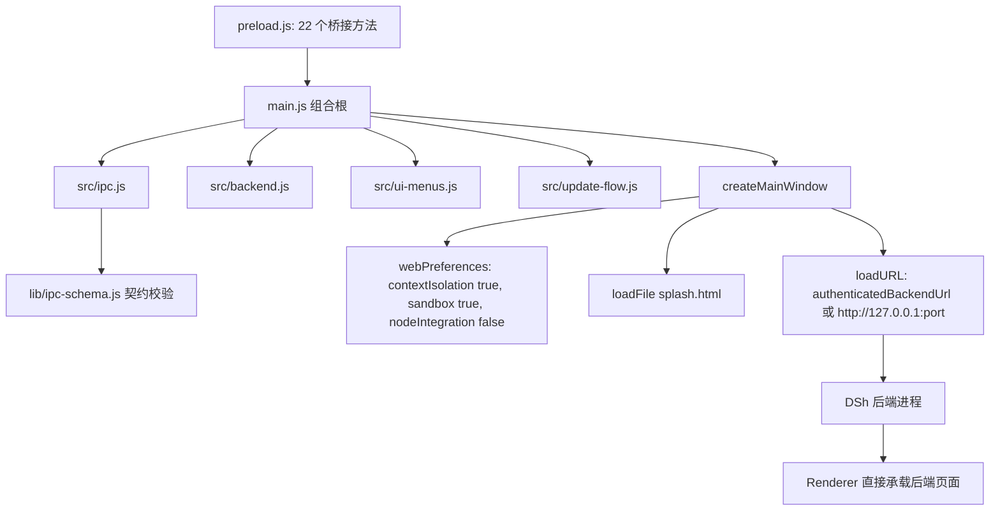
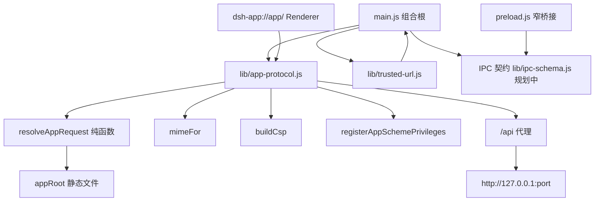
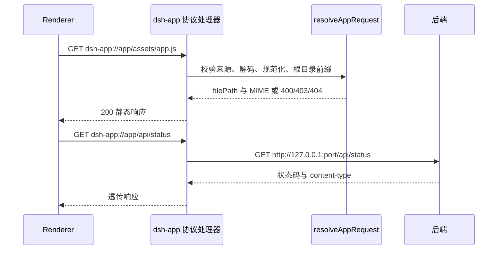

# 架构说明

本文描述 DeepSeek Harness Desktop 外壳的**当前架构**与**目标架构**。`dsh-app://` 协议模块已接入 `main.js`：协议权限在模块加载期注册，`/api` 代理与 CSP 注入由 `installAppProtocolHandler` 完成，但受环境变量 `DSH_ENABLE_APP_PROTOCOL`（默认关闭）门控。默认运行时渲染层仍直接加载后端 HTTP 地址，因为内核前端静态资源目前仍由 DSH 后端服务提供，待构建产物本地化后再切换 `loadURL('dsh-app://app/')`。

## 1. 基线与范围

- 运行时：Electron 37、Node.js 22、CommonJS、`node:test`。
- 主进程入口：`main.js`。
- 渲染层桥接：`preload.js`。
- 可信 URL 判定：`lib/trusted-url.js`（接受主窗口、精确 `splash.html`、后端端口、`dsh-app://app` 来源）。
- 本次新增：`lib/app-protocol.js`、`lib/ipc-schema.js`、`lib/i18n.js`、`lib/python-runtime.js`、`lib/secure-exec.js`、`lib/readiness.js`、`lib/restart-guard.js`、`lib/update-manifest.js`、`lib/update-source-policy.js` 及其单测与本文档。
- 本次修改：`main.js`（IPC 契约校验、i18n、协议接线、更新源策略）、`lib/updater.js`、`prepare-runtime.js`、`package.json`。
- 本次未修改：`preload.js`（窄桥接收敛列为后续目标）。

## 2. 当前架构

### 2.1 结构与加载方式

`main.js` 是组合根（portable 路径引导、`dsh-app` 协议安装、窗口创建、`whenReady` 编排），其余能力已按职责拆分到 `src/` 与 `lib/`：

| 模块 | 职责 |
| --- | --- |
| `src/backend.js` | 后端子进程启动/终止、崩溃重启决策接线、local-runtime 启动看门狗与熔断 |
| `src/ui-menus.js` | 托盘、原生应用菜单、自修复入口 |
| `src/update-flow.js` | 更新检查编排、回退出厂运行时、旧损坏目录清理 |
| `src/ipc.js` | 全部 IPC handler 集中注册（含无参通道白名单） |
| `src/worktree.js` | git worktree 隔离会话管理 |
| `src/runtime-layout.js` | runtime 目录布局与版本探测 |
| `src/preset-plugins.js` | 预置插件水合 |
| `src/clipboard.js` | 剪贴板桥接 |
| `lib/context-menu.js`、`lib/update-check.js` | 右键菜单注册、更新检测纯逻辑 |

拆分模块统一采用依赖注入工厂（`createXxx(deps)`），Electron 与 main 状态经 getter/回调注入，行为与单体版本等价。`createMainWindow` 位于 `main.js`，其关键行为如下：

- `BrowserWindow` 使用 `preload.js`，并开启 `contextIsolation: true`、`sandbox: true`、`nodeIntegration: false`、`webviewTag: false`。
- 启动页默认 `loadFile('splash.html')`；设置 `DSH_ENABLE_APP_PROTOCOL=true` 时改用 `dsh-app://app/splash.html`。
- 后端就绪后，通过 `mainWindow.loadURL(authenticatedBackendUrl || http://127.0.0.1:${currentPort})` 直接加载后端页面（整体切到 `dsh-app://app/` 待前端静态产物本地化）。
- `setWindowOpenHandler` 只放行当前后端端口，`will-navigate` 放行后端端口、`dsh-app://app` 与 `file://`，其余交给系统浏览器。
- IPC 发送方校验使用 `lib/trusted-url.js` 的 `isTrustedSender`，允许主窗口、精确匹配的 `splash.html`、精确端口的 `127.0.0.1`/`localhost` 后端页面、以及 `dsh-app://app` 来源。
- 全部 19 个入站 IPC handler 经 `lib/ipc-schema.js` 的 `assertValid` 做集中参数契约校验。

当前请求流：

### 2.2 preload 桥接面

`preload.js` 通过 `contextBridge` 暴露 `dshDesktop` 与 `dshDesktopShell` 两个同名桥对象，共 22 个方法：

- 18 个请求方法，覆盖运行时信息、后端状态、引擎切换、安全模式、右键菜单、工作区、剪贴板、WSL 路径、自启动、置顶、插件、Worktree、更新、自修复、原生通知。
- 4 个事件订阅方法：`onAutoStartChanged`、`onBackendReady`、`onRuntimeLog`、`onInjectClipboard`。

规划书按约 20 个方法概括该桥接面；代码实测为 22 个。当前桥接面偏宽，渲染层可以直接触达大部分桌面能力。

### 2.3 当前边界与问题

- 渲染层页面来源默认仍是后端 HTTP 地址；`dsh-app://` 本地来源已具备能力但受 `DSH_ENABLE_APP_PROTOCOL` 门控。
- 后端页面与桌面桥接处于同一窗口，页面来源即后端来源。
- `dsh-app` 响应已统一注入 CSP；后端 HTTP 页面的 CSP 仍取决于后端自身。
- 本地资源路径校验：`dsh-app` 使用通用静态根目录约束与路径穿越防护；`file://` 启动页仍用精确路径判断。
- 全部 19 个入站 IPC handler 已接入 `lib/ipc-schema.js` 集中参数契约校验。

## 3. 目标架构

> 状态：核心协议层已接入 `main.js`（`DSH_ENABLE_APP_PROTOCOL` 门控，默认关闭）。渲染层整体切到 `dsh-app://app/`、`preload.js` 窄桥接收敛仍属目标设计，待前端静态产物本地化后执行。

### 3.1 总体结构

目标架构把“本地静态资源”和“后端 API”统一收口到自定义协议 `dsh-app://app/`：

- 静态资源由 `dsh-app://app/` 提供，根目录为构建产物目录 `appRoot`。
- `/api/` 开头的请求由协议处理器代理到 `backendOrigin`，透传状态码与 `content-type`。
- 渲染层加载 `dsh-app://app/`，脚本与样式来自受控本地来源。
- `preload.js` 收窄为最小桌面能力集合，IPC 通过集中契约校验。
- CSP 由外壳注入，`script-src 'self'`，`connect-src` 仅 `'self'` 与后端来源，`frame-ancestors 'none'`。

目标模块图：

目标请求流：

### 3.2 协议模块接口

`lib/app-protocol.js` 已实现以下导出：

| 导出 | 作用 |
| --- | --- |
| `resolveAppRequest(requestUrl, { appRoot })` | 仅接受 `dsh-app://app/`，解码并规范化路径，返回 `{ ok, filePath, mime, status }` 或 `{ ok: false, status, reason }` |
| `mimeFor(filePath)` | 返回 html/js/css/json/svg/png/ico/woff2/map 的 MIME，未知类型回退 `application/octet-stream` |
| `buildCsp({ backendOrigin, dev })` | 生成 CSP 字符串，默认 `script-src 'self'`，`connect-src` 仅 `'self'` 与后端来源，`frame-ancestors 'none'` |
| `isAppUrl(url)` | 判定是否为 `dsh-app://app` 来源 |
| `registerAppSchemePrivileges(protocol)` | 注册 `standard`、`secure`、`supportFetchAPI`、`corsEnabled` 四种 privileges |
| `createAppProtocolHandler(options)` | 注册协议 handler，静态请求读取 `appRoot` 文件，`/api/` 请求代理到后端；返回 handler 便于单测 |

`createAppProtocolHandler` 默认同时注册 privileges 与 handler。Electron 要求 `registerSchemesAsPrivileged` 在 `app.whenReady` 之前完成，而 `protocol.handle` 需在就绪之后调用，因此接入时可拆分：

- 启动早期调用 `registerAppSchemePrivileges(protocol)`。
- `app.whenReady` 之后调用 `createAppProtocolHandler({ ..., registerPrivileges: false })`。

### 3.3 窄 preload 与 IPC 契约

目标状态由“宽桥接”收敛为“窄桥接 + 契约校验”：

- preload 只暴露与桌面外壳强相关的少量方法：应用/后端状态读取、引擎切换、自启动、置顶、更新检查、剪贴板注入、后端就绪与日志事件。
- 领域能力（工作区、插件、Worktree 等）按需分组，避免把全部内部能力平铺到 `window`。
- IPC 通道统一使用 `dsh:` 前缀，分为 `invoke` 请求与单向 `send` 事件。
- 主进程侧以 `lib/ipc-schema.js` 集中声明通道、参数结构、返回结构与发送方约束（19 个入站 handler 已接入 `assertValid`）。
- 发送方校验继续以 `lib/trusted-url.js` 为基础，现已接受 `dsh-app://app` 来源。

### 3.4 安全边界

| 边界 | 当前 | 目标 |
| --- | --- | --- |
| 渲染来源 | 后端 HTTP 地址 | `dsh-app://app/` |
| 静态资源 | 无独立资源根 | `appRoot` 前缀校验，目录回退 `index.html` |
| 路径穿越 | 仅启动页精确路径判断 | 拒绝 `..`、编码穿越、绝对路径、盘符路径、符号链接越界 |
| 协议权限 | 无自定义协议 | `standard`、`secure`、`supportFetchAPI`、`corsEnabled` |
| CSP | 外壳未统一注入 | `script-src 'self'`、受控 `connect-src`、`frame-ancestors 'none'` |
| API 访问 | 渲染层直连后端 | 协议内 `/api/` 代理，来源收敛 |
| preload | 22 个方法平铺 | 窄桥接分组 |
| IPC | 逐处理函数校验 | 集中契约 + 发送方校验 |

## 4. 接入 main.js 所需步骤

1. ✅ 在 `app.whenReady` 之前调用 `registerAppSchemePrivileges(protocol)`，确保 `dsh-app` 获得标准、安全、可 fetch、支持 CORS 的协议权限。（已实现：模块加载期顶层调用）
2. ⏳ 确认构建产物目录并作为 `appRoot`，同时把该目录加入 `package.json` 的打包文件清单；当前 `build.files` 只包含 `main.js`、`preload.js`、`splash.html`、`lib/`、`build/`、`dsh-runtime/`。（现以模块目录为 `appRoot`，静态服务能力已可用；`index.html` 待内核前端产物本地化后纳入）
3. ✅ 在 `app.whenReady` 之后调用 `createAppProtocolHandler({ protocol, net, appRoot, backendOrigin, registerPrivileges: false })`，`backendOrigin` 使用当前后端地址。（已实现：`installAppProtocolHandler`；`DSH_ENABLE_APP_PROTOCOL=true` 时启用）
4. ✅ 后端地址同步：`setWindowOpenHandler` 维持后端 HTTP 白名单，`will-navigate` 已增加 `isAppUrl` 判定；启动 splash 在开关开启时改用 `dsh-app://app/splash.html`；后端每次就绪后重装 handler 以刷新 `backendOrigin`。渲染主界面 `loadURL('dsh-app://app/')` 切换待步骤 2 完成。
5. ✅ CSP：`dsh-app` 响应经封装 handler 注入 `buildCsp({ backendOrigin, dev })` 头（等价于 `onHeadersReceived`，实现更贴近协议层）。
6. ✅ 扩展 `lib/trusted-url.js`，让 `isTrustedSender` 接受 `dsh-app://app` 来源，并补充对应单测。
7. ⏳ 把 `preload.js` 收敛到窄桥接，并接入 `lib/ipc-schema.js` 的集中校验。（IPC schema 校验已在主进程 19 个 handler 全量落地；preload 收敛待进行）
8. ⏳ 增加端到端验证：静态资源加载、`/api` 代理、路径穿越拒绝、CSP 生效、后端重启后代理地址更新。（协议层单测与集成静态断言已覆盖路径穿越与 CSP 构造；端到端需 GUI 环境）

## 5. 当前验证状态

- `node --test test/app-protocol.test.js`：19 个用例通过。
- `node --test test/app-protocol-integration.test.js`：主进程接线静态断言通过。
- `npm test`：156 个用例全部通过。
- 协议模块已通过 `DSH_ENABLE_APP_PROTOCOL` 接入主进程；默认关闭时运行时仍按原有 HTTP 直接加载方式，行为与 0.2.1 基线一致。
