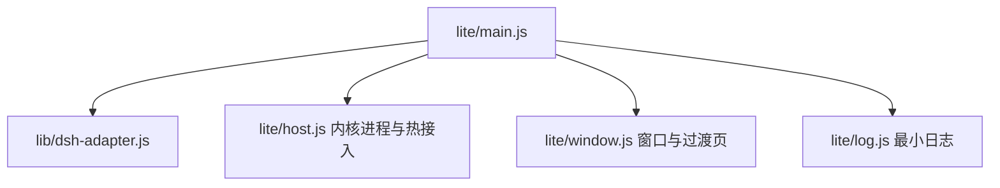

# 极致轻量外壳规划

目标：只保留「启动内置 DSH 并显示页面」这一件事，没有任何附加功能，并让打开速度稳定快过用浏览器访问 DSH 网页。

## 1. 边界：只砍外壳自建功能

DSH 原生功能全部保留。它们运行在内核的 Web UI 里，与外壳无关，轻量版照常使用：

- 工作区浏览与管理、会话列表与搜索、归档与分叉
- 插件管理与插件市场、设置页、模型与 API Key 配置
- 应用内快捷键、计划任务、诊断日志

外壳只做「把内核拉起来并显示」，移除所有自建能力：

| 移除 | 原因 |
| --- | --- |
| 托盘、原生菜单、通知 | DSH 界面已能完成操作，托盘属于额外入口 |
| 全局快捷键、开机自启、置顶 | 附加功能 |
| i18n 语言包 | 外壳只剩启动页与错误提示，直接写中文 |
| 便携模式、WSL2、worktree、安全模式 | 附加运行形态 |
| 自愈菜单、CLI 注册、右键菜单、剪贴板桥 | 附加功能 |
| IPC 动作集（保留最小就绪事件） | 页面不需要桌面能力 |
| 内核热更新、外壳自更新、更新检查、journal、last-good | 更新改为重跑部署脚本 |

保留：单实例、单窗口、启动过渡页、拉起内核、认证 URL 捕获、加载页面、关闭即退出、最小错误日志、部署时安装的预置插件。

## 2. 启动模型

两条路径的成本构成：

| 路径 | 组成 | 估算 |
|---|---|---|
| 网页路径 | 启动 `dsh web`（内核引导）+ 打开浏览器 + 导航与首帧 | 浏览器已开时 2.5–3.5 s；冷开浏览器 3.5–5 s |
| 外壳冷启动 | Electron 启动 + 内核引导 + 首帧 | 约 3.0 s |
| 外壳热接入 | Electron 启动 + 附加已运行的内核 + 首帧 | 约 0.8–1.2 s |

结论要说清楚：

- **冷启动快不过网页多少**。两条路径都要付内核引导的 2–3 秒，Electron 相对浏览器只能省下几百毫秒。
- **要稳定快过网页，必须让内核常驻**。窗口打开时只做附加，打开速度就等于 Electron 启动时间。

## 3. 两种模式

### 冷启动模式（默认，零后台）

- 部署时完成 profile 水合、插件安装、能力探测，启动阶段只读取。
- 启动流程：Electron 起来 → 显示过渡页 → 拉起内核 → 认证 URL → 加载页面。
- 优点：退干净、无后台常驻、内存占用只在打开期间。
- 缺点：打开速度与网页同量级。

### 热接入模式（可选，推荐给高频使用）

- 内核作为独立进程常驻，状态写入 `$DSH_HOME/host-state.json`：端口、Token、PID、启动时间。
- 应用启动时先读状态并探活；存活就直接加载页面，不重新拉起内核。
- 窗口关闭后内核保留；空闲超过 30 分钟自动退出，释放内存。
- 用户主动退出或部署脚本可显式停止常驻内核。
- 状态文件只存本机回环端口与短期 Token，写入用户目录并限制为当前用户可读。
- 优点：窗口打开约 0.8–1.2 s，稳定快过网页。
- 代价：后台内存约 200–400 MB（上游内核决定），需要空闲回收。

部署脚本提供 `--lite`（冷启动）与 `--lite-warm`（注册登录后预热 + 热接入）两个选项，默认冷启动。

## 4. 冷启动路径上的具体优化

| 环节 | 做法 | 收益 |
|---|---|---|
| 首次 profile 水合 | 部署阶段写 `$DSH_HOME/profiles/web` | 消除首次 0.2–10 s 长尾 |
| 能力探测 | 部署阶段生成 `capabilities.json` | 消除首启 0.5–5 s 阻塞 |
| 端口 | 传 `--port 0`，从认证 URL 读真实端口 | 省 10–100 ms，消除端口竞争 |
| 就绪轮询 | 400 ms → 100 ms | 平均 150 ms |
| Node 编译缓存 | `NODE_COMPILE_CACHE=$DSH_HOME/.compile-cache` | 约 20%（容器内 2.58 → 2.07 s） |
| 模块加载 | 轻量入口只依赖 adapter 与退避模块 | 数十毫秒 |
| preload | 不注入任何桥接 | 减少渲染初始化 |
| 过渡页 | 窗口先出，后端就绪再换页 | 感知启动最优 |
| 更新检查 | 不检查 | 去除后台噪声 |

## 4.1 磁盘占用

实测（Linux 容器，Electron 二进制未计入）：

| 部分 | 体积 |
| --- | ---: |
| 外壳源码（当前标准版） | 356 KB |
| 轻量版外壳源码（预计） | 50–100 KB |
| Electron 运行时（Windows 解包） | 约 250 MB |
| DSH 内核与依赖 | 约 850 MB |
| 9 个预置插件 | 约 30 MB（含传递依赖 50–150 MB） |
| Python 运行时（可选，不装为 0） | 150–300 MB |

典型部署占用 1.1–1.3 GB，外壳本身占不到 1 MB。可继续压缩的部分：

- 从 `devDependencies` 移除 `@deepseek-ai/dsh`，部署时的开发依赖树可少约 600 MB
- 部署只安装 Electron，不装 eslint 与 playwright
- 试 `npm install --omit=optional` 安装内核，可能省下 node-pty、@img 等 100 MB 以上
- 不生成 Python 运行时

## 5. 目标指标

| 指标 | 冷启动目标 | 热接入目标 |
|---|---|---|
| 窗口与过渡页可见 | ≤ 1.0 s | ≤ 1.0 s |
| 页面可交互 | ≤ 3.0 s | ≤ 1.5 s |
| 主进程 RSS | ≤ 200 MB | ≤ 200 MB |
| 轻量版源码 | ≤ 1000 行 | 同左 |
| 生产依赖 | 0 | 0 |

说明：当前容器内存紧张，内核启动实测在 2.1–17 s 之间波动，以上指标必须在 Windows 实机复测；容器数据只用于比较相对收益。

## 6. 结构

- `lite/host.js` 负责三种情况：附加存活内核、冷启动内核、超时提示。
- 热接入检测：读 `host-state.json` → HTTP 探活 → 校验认证 URL 可用 → 直接加载。
- 冷启动与热接入共用同一套 Token 解析与版本范围校验。

## 7. 实施阶段

1. P1 冷启动外壳：入口、窗口、拉起内核、加载页面，约 1 天。
2. P2 冷启动优化：部署期水合与能力探测、编译缓存、端口 0、100 ms 轮询，约 1 天。
3. P3 热接入：常驻内核、状态文件、探活、空闲回收、部署开关，约 1.5 天。
4. P4 验收：Windows 实机测三组数据（网页路径、冷启动、热接入），约半天。

## 8. 风险

- 热接入引入后台进程，与「极致轻量」的直觉冲突；用空闲自动退出控制常驻时间。
- Token 与端口写入状态文件，必须限制文件权限，且只绑定 127.0.0.1。
- 上游内核升级后状态文件可能失效，探活失败要自动回落到冷启动。
- 指标以 Windows 实机为准，容器测量只用于相对比较。

## 9. 不做什么

- 不做 V8 自定义快照、不修改 Electron 二进制。
- 不为速度削减预置插件。
- 不保留任何更新、自愈、托盘类功能。
