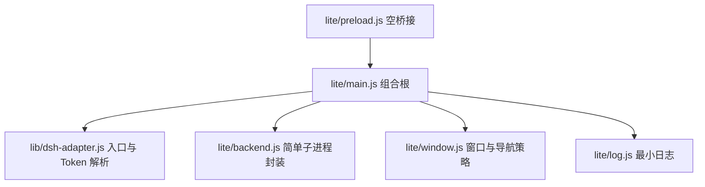

# 极致轻量版规划

目标：一个只有内置 DSH 与预置插件、没有其它附加功能的外壳变体，并把启动速度压到可测量、可回归的水平。

## 1. 实测基线

在本机（Linux 容器，无 Electron 窗口）直接测 `@deepseek-ai/dsh@0.2.1-rc.5` 启动到打印认证 URL 的时间：

| 场景 | 耗时 |
|---|---|
| 全新 `DSH_HOME` 首次初始化 | 2.7 s（机器繁忙时抖动到 12.5 s） |
| 复用 profile | 2.51 s / 2.58 s |
| 复用 profile + 预热 Node 编译缓存 | 2.07 s |
| Node 编译缓存目录体积 | 28 MB |

结论：

- 后端引导约 2–2.5 s，是 Electron 之外的主要启动成本。
- 编译缓存稳定省下约 0.5 s（约 20%）。
- 首次 profile 初始化存在长尾，必须挪到部署阶段完成。

## 2. 功能范围

### 保留

- 单实例、单窗口、启动过渡页
- 后端子进程启动、Token URL 捕获、加载 Web UI
- 关闭窗口即退出（不驻留托盘）
- 后端崩溃的有限自动重启（固定次数，无菜单）
- 9 个预置插件随部署一次性装好
- 最小日志文件，便于排障

### 移除

- 托盘、原生菜单、全局快捷键、通知
- i18n 语言包与切换
- 便携模式、WSL2、worktree、安全模式
- 自愈菜单、CLI 注册、右键菜单、开机自启、置顶
- 内核热更新、外壳自更新、更新检查、journal、last-good
- 剪贴板桥、IPC 动作集（保留最小 ready 事件即可）

更新方式改为：重新运行部署脚本。轻量版不承担更新职责。

## 3. 启动耗时的来源与优化

| 环节 | 现状 | 优化 | 预计收益 |
|---|---|---|---|
| Electron 主进程启动 | 固定成本 | 无法压缩 | 0 |
| `main.js` 与依赖加载 | 60 余个模块 | 轻量版独立入口，只依赖 Electron 与 3 个 lib | 数十毫秒 |
| 首次 profile 水合 | 启动时同步执行 | 部署阶段写 `$DSH_HOME/profiles/web` | 消除 0.2–10 s 长尾 |
| 能力探测 `dsh web --help` | 首次启动 spawnSync | 部署阶段生成 capabilities JSON | 消除 0.5–5 s 首启阻塞 |
| 端口探测 | 最多 50 次连接 | `--port 0`，读认证 URL 的真实端口 | 10–100 ms |
| 就绪轮询 | 400 ms | 100 ms | 平均 150 ms |
| Node 模块编译 | 每次冷编译 | 设 `NODE_COMPILE_CACHE=$DSH_HOME/.compile-cache` | 约 500 ms |
| 首次渲染 | splash 后等后端 | 保持 splash 先出 | 感知启动已优化 |
| 更新检查 | 启动 5 s 后 | 轻量版不检查 | 移除后台噪声 |

轻量版目标是把「窗口出现」压到 Electron 下限，把「DSH 页面可用」压到 2 s 左右（本机基线），Windows 上以实机测量为准。

## 4. 目标指标

| 指标 | 目标 | 测法 |
|---|---|---|
| 主进程加载到 splash 可见 | ≤ 1.5 s | Electron e2e 打点 |
| 后端打印认证 URL（预热缓存） | ≤ 2.5 s | `measure-boot` 脚本 |
| 页面首次可交互 | ≤ 3.5 s | e2e 等待 `#root` 渲染 |
| 主进程 RSS（空载） | ≤ 200 MB | e2e `process.memoryUsage()` |
| 轻量版源码规模 | ≤ 1200 行 | `npm run footprint` |
| 生产依赖 | 0 | `package.json` |

## 5. 结构设计

- 独立入口 `lite/main.js`，不引入现有 `src/` 的重型模块。
- 复用 `lib/dsh-adapter.js`：入口解析、启动参数、认证 URL 解析、版本范围。
- 复用 `lib/backend-lifecycle.js` 的退避策略，避免重写崩溃计数。
- preload 保留空实现，避免页面拿到桌面能力。
- 部署脚本增加 `--lite` 分支：准备 profile、生成 capabilities、安装插件后直接完成，不在启动时做。

## 6. 实施阶段

### P0 规划（本文）

产出范围、指标、结构。

### P1 轻量入口（约 1 天）

- 新增 `lite/main.js`、`lite/backend.js`、`lite/window.js`、`lite/log.js`、`lite/preload.js`
- `npm run start:lite` 可用
- 用 `measure-boot` 与 e2e 打点记录首版数据

### P2 启动优化（约 1 天）

- 后端环境注入 `NODE_COMPILE_CACHE`
- 端口改为 `--port 0` + 读取认证 URL 端口
- 就绪轮询 100 ms
- 窗口先显示 splash，后端就绪后加载 URL

### P3 部署集成（约 1 天）

- 部署阶段完成 profile 水合、插件安装、capabilities 生成
- `一键部署.bat` 增加轻量模式选择
- 启动时只做读取与拉起

### P4 验收（约半天）

- 指标表逐项打点
- 与标准版对比冷启动、RSS、源码规模
- 补文档与回归脚本

## 7. 风险

- 插件数量直接影响后端启动时间；如果 9 个插件让预热启动明显超过 2.5 s，需要逐个测量并决定是否分阶段启用。
- 移除更新能力后，内核升级依赖用户重跑部署脚本，需要在启动页明确提示版本与更新方式。
- 轻量版与标准版共用 `lib/dsh-adapter.js`，适配层变更要同时回归两个入口。
- Windows 实机与 Linux 容器的绝对耗时会不同，指标以 Windows 实机复测为准。

## 8. 不做什么

- 不做 V8 自定义快照、不做 Electron 预加载调优层面的非常规手段。
- 不为了启动速度削减插件功能。
- 不保留两套更新实现，轻量版不更新。
