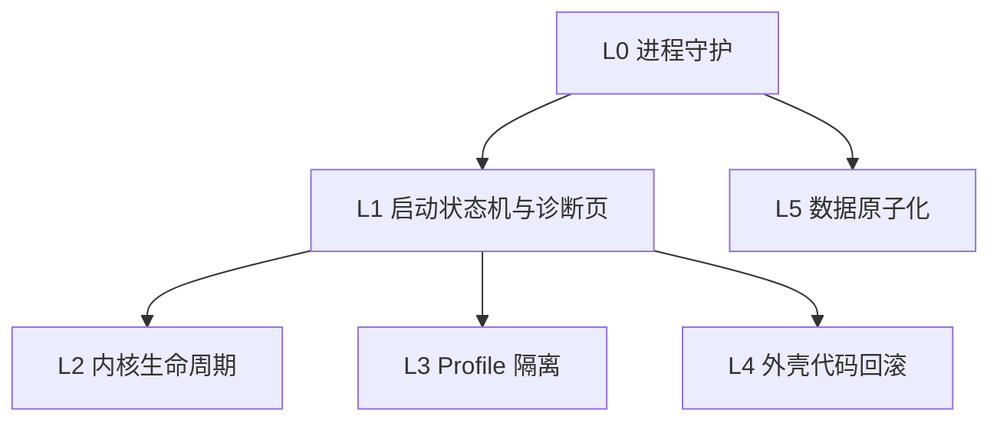

# 抗更新崩溃设计

本文定义「无论内核或外壳怎么更新，应用都不会把用户卡死」的目标、失效面、不变式和分层机制。当前实现与本设计的差距在最后一节列出。

## 1. 目标定义

绝对意义上的「不崩」不存在：进程可能被系统杀死、磁盘可能写坏、用户可能强杀。可承诺的是「不把用户卡死」：

1. 进程无论怎么失败，下一次启动都能起来。
2. 窗口永远有内容：正常界面、启动页或诊断页，三者之一。
3. 任何更新都可回退，回退后保持最后一次可用状态。
4. 连续失败会降级，不会无限重启。
5. 用户数据与配置永不因更新或回滚丢失。

## 2. 失效面

| 层 | 典型故障 | 现有处理 | 缺口 |
| --- | --- | --- | --- |
| 渲染进程 | 页面崩溃、内存耗尽 | `render-process-gone` 写崩溃报告 | 不重建窗口，用户看到空白 |
| 主进程 | 未捕获异常、未处理拒绝 | 写崩溃报告后重新抛出 | 应用直接退出，可能反复崩溃 |
| 内核进程 | 启动失败、崩溃循环、就绪超时 | 退避重启、看门狗、熔断、回退出厂内核 | 用户 profile 损坏时仍会反复失败 |
| 内核更新 | 新版本行为不兼容 | 契约验证、last-good、隔离、journal | 已完成 |
| 外壳更新 | 拉取到有缺陷的提交 | 依赖安装失败回滚 | 代码本身能启动但功能坏时无回退 |
| 配置与数据 | JSON 损坏、权限不足 | 各存储单独容错 | 缺少统一的原子写与恢复策略 |
| 端口 | 被占用、上游忽略参数 | 端口探测、跟随上游端口 | 已完成 |
| 平台 | 系统关机、休眠、强杀 | 无 | 只影响进行中的更新，靠 journal 恢复 |

## 3. 不变式

- I1 主进程不因业务异常退出；致命异常必须走受控重启。
- I2 启动有硬超时，超时进入诊断页而不是无限等待。
- I3 更新遵循 staging → verify → promote → rollback，任一步失败保持旧状态。
- I4 连续失败按阶梯降级：正常 → 安全模式 → 出厂内核 → 干净 profile → 诊断页。
- I5 所有持久化写入原子化，读取失败回退默认值。
- I6 每次启动都能回答三个问题：上次为什么失败、现在用的什么版本、如何回退。

## 4. 分层设计

### L0 进程守护

- 全局捕获未处理异常与拒绝，写入崩溃报告和启动计数，不再直接退出。
- 启动计数落盘；连续失败达到阈值时，下一次启动自动带 `--shell-safe-mode`。
- 安全模式下不加载用户插件、不自动更新、不启动托盘，只保证窗口可用。
- 主进程自身退出后由 Electron 主实例路径负责重启，避免静默消失。

### L1 启动状态机与诊断页

- 状态：`boot → backend-start → ready`，每步有超时和失败计数。
- 超过总时限或连续失败达到阈值，直接进入诊断页，而不是继续等待。
- 诊断页提供：重新启动、回退出厂内核、重置 profile、打开日志目录、复制诊断报告。
- 诊断页是纯本地 HTML，不依赖后端、不依赖网络、不依赖用户配置。

### L2 内核生命周期

- 启动前检查内核版本、入口、profile 结构。
- 更新用独立目录 staging，验证通过后原子替换，失败保留旧目录。
- 记录 last-good 版本，失败优先恢复它，出厂内核是最后兜底。
- 就绪超时、崩溃次数、加载失败次数共同决定熔断。

### L3 Profile 隔离

- 后端连续失败且内核本身正常时，判定为 profile 或插件问题。
- 将 `profiles/web` 重命名为带时间戳的备份，从模板重建。
- 重建只发生一次；再次失败进入诊断页，避免反复清空用户配置。
- 用户数据（会话、凭据）与 profile 分离，重建不动数据。

### L4 外壳代码回滚

- 每次外壳更新前记录当前 commit。
- 启动成功（窗口进入 ready）后标记该 commit 为可用。
- 启动失败且上一次动作是外壳更新时，回退到记录的 commit 并重装依赖，再启动一次。
- 回滚失败进入诊断页，并保留原始 commit 以便人工恢复。

### L5 数据原子化

- 统一「写临时文件 → fsync → rename」的写入函数。
- 读取失败返回默认值并记录，不阻断启动。
- 关键状态文件：快捷键、更新 journal、last-good、启动计数。

## 5. 更新路径的原子性

1. 检查：只读远端元数据，不改本地。
2. 下载/安装：写入 staging 目录，不触碰当前内核。
3. 验证：启动 staging 内核，跑认证与页面契约。
4. 切换：重命名旧目录为备份，把 staging 改名为正式目录。
5. 回滚：切换后启动失败，按 last-good、旧目录、出厂内核的顺序恢复。
6. 外壳：先记录 commit，拉起后确认 ready 才标记为可用；失败回退 commit。

## 6. 故障注入测试矩阵

| 注入 | 期望 |
| --- | --- |
| 渲染进程被 kill | 窗口重建，显示诊断或重载页 |
| 后端启动即退出 | 计数增加、退避重启、最终熔断 |
| 后端就绪超时 | 看门狗触发，回退 last-good |
| staging 内核契约失败 | 不切换，恢复 last-good |
| profile 损坏 | 隔离并重建一次，用户数据保留 |
| 快捷键/工作区/journal 损坏 | 回退默认值，应用正常启动 |
| userData 不可写 | 退到临时目录，应用仍启动 |
| 外壳更新后启动失败 | 回滚 commit 并重装依赖 |
| 连续三次启动失败 | 第 4 次进入诊断页，不再循环 |

## 7. 当前状态

已完成：

- 内核契约验证、last-good、隔离、更新 journal 与中断恢复
- 启动看门狗、崩溃退避、熔断、出厂内核回退
- 崩溃报告、操作日志、各配置文件的容错读取

未完成：

- 主进程受控重启与启动计数（L0）
- 渲染进程崩溃后的窗口重建（L0/L1）
- 启动总超时与诊断页（L1）
- profile 损坏的自动隔离重建（L3）
- 外壳 commit 级回滚（L4）
- 统一原子写与不可写目录 fallback（L5）

## 8. 实施顺序与工作量

1. L0 进程守护与启动计数（约 1 天）：收益最大，防止「启动即死」。
2. L1 启动超时与诊断页（约 2 天）：保证任何情况下有可用界面。
3. L3 profile 隔离（约 1 天）：解决插件导致的反复失败。
4. L5 原子写与目录 fallback（约 1 天）：消除配置损坏类问题。
5. L4 外壳 commit 回滚（约 2 天）：最后一块闭环，依赖 L0 的启动计数。

验收以第 6 节矩阵为准，每项都要有自动化用例；L1 与 L0 的窗口行为用 Electron e2e 覆盖，其余用现有假 Electron 集成测试。

## 9. 明确不做

- 不做操作系统级看护进程。
- 不做跨机器同步或云端恢复。
- 不承诺进程被杀后无感恢复，只保证下次启动可用。
