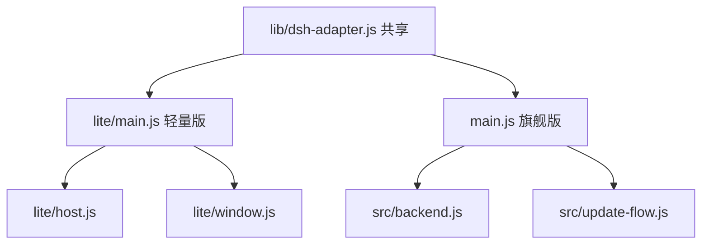

# 版本规划：极致轻量版与旗舰版

一个仓库，两种形态，共享同一套内核接入与部署脚本。

## 1. 定位

| | 极致轻量版（Lite） | 旗舰版（Flagship） |
| --- | --- | --- |
| 目标 | 占地最小，功能全部交给 DSH | 桌面体验与故障恢复 |
| 外壳源码 | 50–100 KB，≤1000 行 | 约 7,300 行 |
| 附加功能 | 无 | 仅 DSH 不提供的桌面能力 |
| 启动 | 冷启动接近 Electron 下限 | 冷启动 + 可选热接入 |
| 维护成本 | 极低 | 中 |

## 2. 共享部分

- `lib/dsh-adapter.js`：内核入口解析、启动参数、认证 URL 解析、版本范围
- 内核拉起与 Token 捕获的公共流程
- `一键部署.bat`：拉代码、装依赖、准备运行时、安装预置插件
- 内核与插件的安装结果、`DSH_HOME` 布局

两档都不重复实现 DSH 自带的工作区、会话、插件管理、设置、应用内快捷键。

## 3. 极致轻量版

### 保留

- 单实例、单窗口、启动过渡页
- 拉起内核、捕获认证 URL、加载页面
- 关闭窗口即退出
- 最小错误日志
- 部署时安装的 9 个预置插件

### 移除

托盘、原生菜单、全局快捷键、通知、i18n、便携模式、WSL2、worktree、安全模式、自愈、CLI 注册、右键菜单、自启、置顶、剪贴板桥、IPC 动作集、内核热更新、外壳自更新、更新检查、journal、last-good、崩溃报告 UI。

### 关键设计

- **不注入 preload**。DSH 客户端通过 `document.documentElement.dataset.platform` 判断是否桌面环境；不设置该标记时 DSH 以 Web 运行时工作，工作区、插件市场、设置、快捷键全部照常可用。
- 预置插件、profile 水合、能力探测全部在部署阶段完成，启动只读。
- 后端启动注入 `NODE_COMPILE_CACHE`，实测约省 20% 引导时间。
- 传 `--port 0`，从认证 URL 读取真实端口，避免端口探测与竞争。
- 就绪轮询 100 ms，窗口先显示过渡页。
- 可选热接入：内核常驻，启动时探活后直接附加；窗口关闭后保留，空闲 30 分钟退出。

### 磁盘优先策略（实测）

轻量版不再把速度当目标，改为尽可能少占磁盘。实测数据：

| 项 | 裁剪前 | 裁剪后 |
| --- | ---: | ---: |
| 内核依赖树 | 863 MB | **561 MB** |
| 删除内容 | — | `*.map` 38 MB、`*.md` 9 MB、`*.d.ts` 39 MB、`test/tests` 59 MB、`*.ts` 156 MB |
| 契约检查 | 通过 | **通过（认证 URL、401、Cookie、Web 外壳 4/4）** |

裁剪只删除源码、类型声明、文档与测试目录，运行时依赖与原生二进制全部保留，DSH 功能不受影响。

轻量版必须是桌面窗口，浏览器应用窗口模式不作为选项。两种可用的桌面形态：

| 形态 | 外壳 | 内核 | 插件 | 合计 |
| --- | ---: | ---: | ---: | ---: |
| Electron 外壳 | 276 MB（只留 zh-CN 语言包） | 约 540–560 MB | 约 30 MB | **约 850 MB** |
| WebView2 外壳 | 70–90 MB 自包含 exe | 约 540–560 MB | 约 30 MB | **约 650 MB** |

Electron 37.10.3 Windows 解包 318 MB，其中 locales 43 MB；只保留 `zh-CN.pak` 后约 276 MB，省 42 MB。

内核在 Windows 目标上额外按平台裁剪：删除 `linux-*`、`darwin-*`、`win32-arm64` 等异平台目录、`docs/examples/benchmarks/coverage` 与 `.d.mts`/`.d.cts` 声明文件。Windows 侧的实际节省需要实机确认，部署脚本会在裁剪后立即跑契约检查，失败即中止。

WebView2 形态见 `webview2/`：WinForms + WebView2，约 350 行 C#，拉起内核、解析认证 URL、关闭即结束进程。CI 工作流 `WebView2 Lite` 在 `windows-latest` 上发布自包含 exe。

### 部署时自动裁剪

部署流程增加一步：安装内核后删除非运行时文件，再跑兼容检查与契约检查；检查失败则重新安装，不保留裁剪结果。

### 指标

| 指标 | 目标 |
| --- | --- |
| 磁盘占用（Electron 形态） | ≤ 900 MB |
| 磁盘占用（Web 形态） | ≤ 600 MB |
| 外壳源码 | ≤ 100 KB |
| 启动速度 | 不再设目标 |

## 4. 旗舰版

### 保留（DSH 不提供的桌面能力）

- 托盘驻留、全局呼出、关闭到托盘、首次隐藏确认
- 退出前后端状态确认
- 启动自愈、安全模式、内核热更新与回退（契约验证、last-good、journal）
- 崩溃报告、操作日志
- 便携模式、WSL2 引擎、git worktree
- `dsh` 命令行注册、Windows 右键菜单、开机自启
- 外壳 i18n（只覆盖外壳自己的菜单与弹窗）

### 已移除的重复项

- 工作区菜单与最近列表（DSH 自带工作区管理）
- 「恢复出厂预置插件」菜单（DSH 插件管理器负责）
- 快捷键配置文件与菜单（DSH 自带应用内快捷键）
- 安装包、签名清单、更新清单验签（改为源码部署）

### 明确不做

- 不实现官方桌面的 `dshDesktop.keyboard` / `dshDesktop.shortcuts` 原生桥。DSH 只有在 `dataset.platform` 存在时才走桌面快捷键路径；我们不设置该标记，DSH 使用自己的 Web 快捷键实现，功能完整且零重复。

### 已实现

- `lite/main.js`：单实例、单窗口、过渡页、拉起内核、解析认证 URL、关闭即退出
- `lite/backend.js`：内核入口解析、能力探测缓存、`--port 0`、Token 捕获、超时与退出处理
- `lite/log.js`：最小日志，写入 `$DSH_HOME/logs/lite.log`
- 启动方式：`npm run start:lite`，或部署目录里的 `一键启动-轻量.bat`
- 不注入 preload，DSH 以 Web 运行时工作，自带功能全部可用

## 5. 代码组织

- 新增 `lite/` 目录，独立入口，不引用 `src/` 的重型模块。
- `package.json` 增加 `start:lite`。
- 部署脚本参数：默认旗舰版，`--lite` 轻量冷启动，`--lite-warm` 轻量热接入。

## 6. 实施阶段

1. **共享层**（0.5 天）：确保 `lib/dsh-adapter.js` 与 Token 解析可被两个入口复用，去掉对 `main.js` 状态的隐式依赖。
2. **Lite 入口**（1 天）：窗口、过渡页、拉起内核、加载页面、关闭退出。
3. **Lite 提速**（1 天）：部署期水合与能力探测、编译缓存、端口 0、100 ms 轮询。
4. **Lite 热接入**（1.5 天，可选）：常驻内核、状态文件、探活、空闲回收。
5. **旗舰版收尾**（0.5 天）：复核没有残留重复功能，更新文档与部署脚本参数。
6. **Windows 实机验收**（0.5 天）：三种路径（网页、Lite 冷启动、Lite 热接入）对比耗时与内存。

## 7. 验收矩阵

| 项 | Lite | Flagship |
| --- | --- | --- |
| DSH 工作区可用 | 是 | 是 |
| DSH 插件管理与市场可用 | 是 | 是 |
| DSH 设置与快捷键可用 | 是 | 是 |
| 托盘与全局呼出 | 无 | 有 |
| 内核更新与回退 | 无（重跑部署） | 有 |
| 启动耗时 | 最低 | 受附加功能影响 |
| 崩溃恢复 | 仅提示 | 自愈 + 回退 |

## 8. 风险

- Lite 不注入 preload 后，DSH 会按 Web 运行；若 DSH 未来依赖桌面标记才开放某些能力，需要重新评估。
- 热接入带来常驻内存，用空闲回收控制；作为可选开关。
- 两档共用 adapter，改动需同时回归两条入口。
- 指标以 Windows 实机为准，容器测量只比较相对收益。
